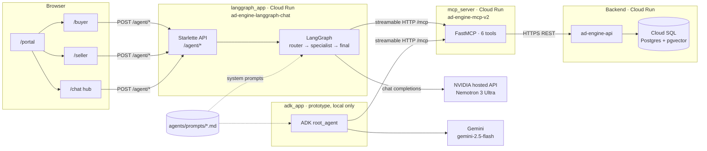
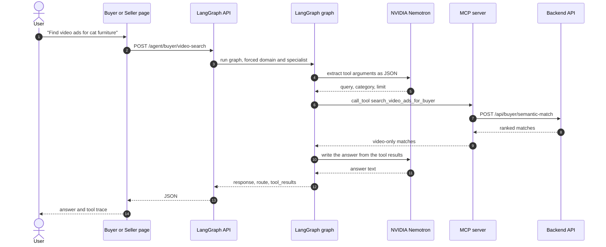

# LLM Ad Engine

LLM Ad Engine is a LangGraph-based agent layer for testing buyer and seller workflows on top of an ad marketplace backend.

It uses:

- NVIDIA hosted API for LLM inference
- LangGraph for orchestration
- FastMCP for tool access
- Google Cloud Run for deployment

## What This Repo Contains

- `langgraph_app/`: the deployed agent runtime and browser chat UI
- `adk_app/`: a parallel Google ADK 2.0 prototype for side-by-side evaluation
- `mcp_server/`: the Python FastMCP server that exposes buyer and seller tools
- `agents/`: prompt files and registry for the LangGraph agents
- `docs/`: deployment notes, smoke tests, and migration plans

## Current Architecture



One request, end to end:



1. A user opens the buyer site, seller site, or shared agent hub.
2. The LangGraph app receives the request.
3. LangGraph calls NVIDIA hosted inference at `https://integrate.api.nvidia.com/v1`.
4. LangGraph calls the MCP server for tool execution.
5. The MCP server calls the backend API for ads, sellers, billing, and support tickets.
6. The response is returned to the user.

## Public Services

Agent app on Cloud Run:

Endpoints require authentication; contact for demo access
- base URL: `https://ad-engine-langgraph-chat-610270819686.us-west1.run.app`
- portal: `https://ad-engine-langgraph-chat-610270819686.us-west1.run.app/portal`
- buyer site: `https://ad-engine-langgraph-chat-610270819686.us-west1.run.app/buyer`
- seller site: `https://ad-engine-langgraph-chat-610270819686.us-west1.run.app/seller`
- shared hub: `https://ad-engine-langgraph-chat-610270819686.us-west1.run.app/chat`

MCP server on Cloud Run:

- `https://ad-engine-mcp-v2-610270819686.us-west1.run.app/mcp`

Backend API on Cloud Run:

- `https://ad-engine-api-610270819686.us-west1.run.app`

## Main Features

- buyer ad search
- buyer video-ad search
- ad match explanation
- seller billing lookup
- seller ad lookup
- seller billing support ticket creation
- separate buyer and seller test UIs

## Local Development

### 1. LangGraph app

```bash
cd /Users/tzechungkao/llm-ad-engine/langgraph_app
python3 -m venv .venv
source .venv/bin/activate
pip install -r requirements.txt
cp .env.example .env
```

Run the app locally:

```bash
cd /Users/tzechungkao/llm-ad-engine
langgraph_app/.venv/bin/uvicorn langgraph_app.api:app --host 0.0.0.0 --port 8010
```

Local pages:

- `http://127.0.0.1:8010/portal`
- `http://127.0.0.1:8010/buyer`
- `http://127.0.0.1:8010/seller`

### 2. MCP server

```bash
cd /Users/tzechungkao/llm-ad-engine/mcp_server
python3 -m venv .venv
source .venv/bin/activate
pip install -r requirements.txt
cp .env.example .env
python server.py --transport stdio
```

## Important Environment Variables

LangGraph runtime:

```env
LLM_BASE_URL=https://integrate.api.nvidia.com/v1
LLM_MODEL=nvidia/nemotron-3-ultra-550b-a55b
LLM_API_KEY=YOUR_NVIDIA_API_KEY
MCP_SERVER_URL=https://ad-engine-mcp-v2-610270819686.us-west1.run.app/mcp
MCP_SERVER_AUTH_TOKEN=
```

MCP server:

```env
AD_ENGINE_API_BASE_URL=https://ad-engine-api-610270819686.us-west1.run.app
AD_ENGINE_API_TOKEN=
```

## Deploy

Both services run in the GCP project `ad-engine-4da45`, region `us-west1`. Always pass `--project`: the gcloud default project on this machine is a different one.

The env vars, including `LLM_API_KEY` and `AD_ENGINE_API_TOKEN`, are already set on the services. A redeploy without `--set-env-vars` keeps them, so routine deploys only push new code.

Redeploy the LangGraph chat service from the repo root:

```bash
gcloud run deploy ad-engine-langgraph-chat \
  --source . \
  --project ad-engine-4da45 \
  --region us-west1
```

Redeploy the MCP server:

```bash
gcloud run deploy ad-engine-mcp-v2 \
  --source mcp_server \
  --project ad-engine-4da45 \
  --region us-west1
```

To change a setting, use `--update-env-vars`, which changes only the variables you name. Don't use `--set-env-vars` on an existing service: it replaces the whole list, so any variable you leave out (such as the API key) is deleted.

```bash
gcloud run services update ad-engine-langgraph-chat \
  --project ad-engine-4da45 \
  --region us-west1 \
  --update-env-vars LLM_MODEL=nvidia/nemotron-3-ultra-550b-a55b
```

To rotate the NVIDIA key, run the same command with `LLM_API_KEY=<new key>`. A first-time setup from scratch is covered in [docs/langgraph_cloud_run_deploy.md](docs/langgraph_cloud_run_deploy.md).

## Useful Docs

- [langgraph_app/README.md](langgraph_app/README.md)
- [mcp_server/README.md](mcp_server/README.md)
- [docs/agent_entrypoints.md](docs/agent_entrypoints.md)
- [docs/langgraph_cloud_run_deploy.md](docs/langgraph_cloud_run_deploy.md)
- [docs/langgraph_smoke_tests.md](docs/langgraph_smoke_tests.md)
- [docs/nim_gcp_migration_plan.md](docs/nim_gcp_migration_plan.md)

## Roadmap

1. stabilize the buyer video-first flow
2. add app-level guardrails and rate limiting
3. integrate prompt-injection and safety screening
4. add stronger auth and account-scoped protections
5. connect the agent test surfaces to the main ad-engine site
