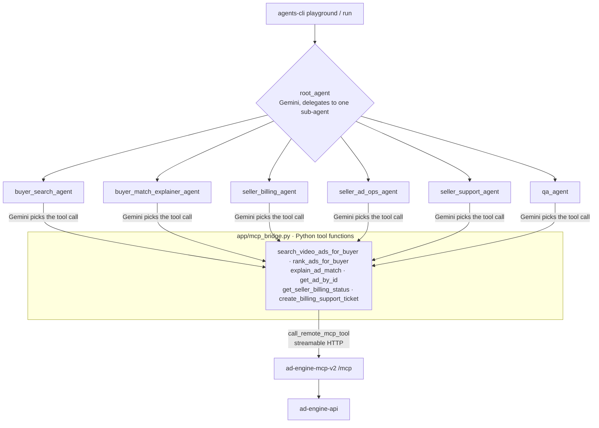
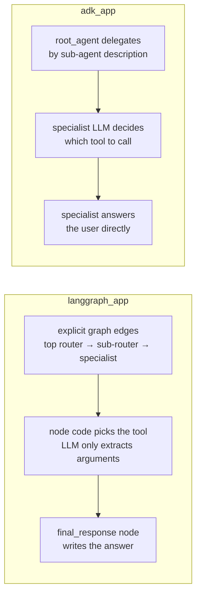

# ADK App

This folder is a parallel Google ADK 2.0 implementation of the LLM Ad Engine.

It does not replace the working LangGraph runtime yet. The goal is to compare:

- orchestration style
- tool routing quality
- local developer experience
- Cloud Run deployment fit

## Current Scope

This first scaffold includes:

- one ADK root coordinator
- buyer search specialist
- buyer match explanation specialist
- seller billing specialist
- seller ad operations specialist
- seller support specialist
- QA specialist
- remote MCP access to the existing deployed MCP server



How it differs from the LangGraph runtime:



## Why A Parallel App

The LangGraph app is already deployed and working. Keeping ADK in a separate
folder lets you evaluate ADK 2.0 without breaking the current public test site.

## Setup

```bash
cd /Users/tzechungkao/llm-ad-engine/adk_app
python3 -m venv .venv
source .venv/bin/activate
pip install -e .
cp .env.example .env
```

Set at least:

```env
GOOGLE_API_KEY=YOUR_GEMINI_API_KEY
ADK_MODEL=gemini-2.5-flash
MCP_SERVER_URL=https://ad-engine-mcp-v2-610270819686.us-west1.run.app/mcp
```

## Run Locally

Using Agents CLI:

```bash
cd /Users/tzechungkao/llm-ad-engine/adk_app
source .venv/bin/activate
agents-cli playground
```

Or single prompt:

```bash
cd /Users/tzechungkao/llm-ad-engine/adk_app
source .venv/bin/activate
agents-cli run "Find video ads for cat furniture"
```

## App Shape

- `app/agent.py`: ADK root agent and sub-agents
- `app/config.py`: environment-driven settings
- `app/mcp_bridge.py`: typed Python tool wrappers that call the deployed MCP server
- `app/prompts.py`: shared prompt loader using the existing prompt files in `/agents/prompts`
- `app/schemas.py`: Pydantic input/output schemas for the specialist agents

## Notes

- This scaffold uses Gemini by default because that is the most direct,
  officially documented ADK path.
- It still talks to your existing MCP server, so the backend and tool layer stay the same.
- If you want NVIDIA behind ADK later, we can add a model-adapter step after the ADK shape is validated.

## Later

Once this prototype looks good, we can add:

1. Cloud Run deployment support for the ADK app
2. guardrail callbacks before tool execution
3. observability and eval wiring
4. stronger auth and account scoping
