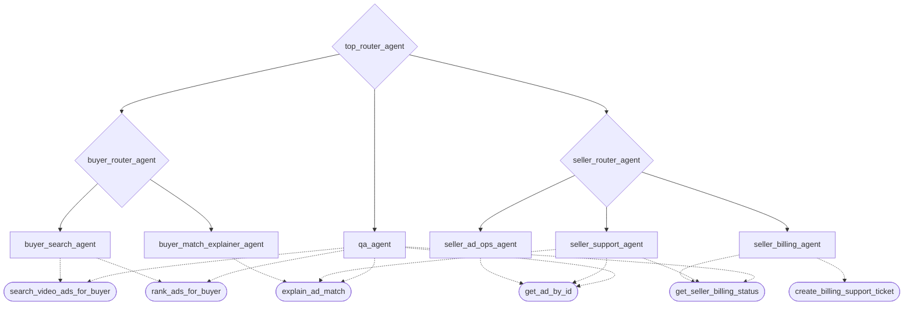
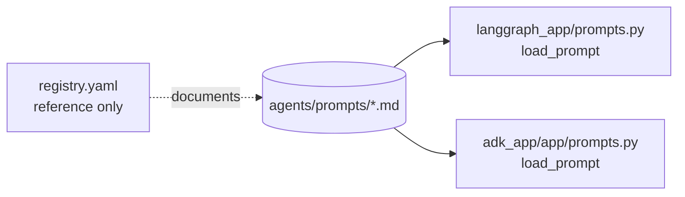

# Agent Scaffolding

This folder holds the agent definitions shared by both runtimes in this repo: the system prompts and an agent registry.

- `langgraph_app/` (deployed) runs these agents on **Nemotron 3 Ultra** through NVIDIA's hosted, OpenAI-compatible API.
- `adk_app/` (prototype) runs the same agents on **Gemini**.
- Both call tools on the **Python FastMCP server** in `mcp_server/`, deployed as `ad-engine-mcp-v2`.

## Graph Shape

- `top_router_agent`
- `buyer_graph`
- `seller_graph`
- `qa_agent`
- `final_response_agent`, the last LangGraph step, which writes the reply from the tool results

Agent hierarchy and the MCP tools each one may call, from `registry.yaml`:



Routers have no tools. Dotted lines are MCP tool calls.

The prompt files are shared by both runtimes:



`registry.yaml` is documentation: neither runtime reads it. The graph wiring lives in `langgraph_app/graph.py` and `adk_app/app/agent.py`.

## Buyer Specialists

- `buyer_search_agent`
- `buyer_match_explainer_agent`

## Seller Specialists

- `seller_ad_ops_agent`
- `seller_billing_agent`
- `seller_support_agent`

## Design Goals

- keep agents small and specialized
- keep buyer and seller flows separate
- make routing explicit
- keep the LLM provider swappable between hosted NVIDIA and self-hosted NIM

## Runtime Topology

- Nemotron 3 Ultra on NVIDIA's hosted API for reasoning (swap `LLM_BASE_URL` to move to self-hosted NIM)
- `ad-engine-mcp-v2` for tool access
- LangGraph as the orchestrator that selects the agent and passes state between steps

## Request Flow (LangGraph)

1. A user request arrives at `/agent/*`.
2. `top_router_agent` classifies the domain (buyer, seller, or qa), unless the endpoint already fixed it.
3. The request enters the buyer or seller subgraph, where a sub-router picks one specialist.
4. The specialist extracts arguments with the LLM and calls MCP tools.
5. `final_response_agent` writes the reply from the tool results.

The `qa_agent` node in LangGraph does not call the LLM: it runs a fixed `rank_ads_for_buyer` smoke check. Its prompt is used only by the ADK app.

## Files

- `registry.yaml`: agent registry, model config, routing overview (reference only, not loaded by either runtime)
- `prompts/*.md`: system prompts for each agent

Prompts loaded by code:

- `top_router_agent.md`, `buyer_router_agent.md`, `seller_router_agent.md`, `final_response_agent.md`: LangGraph only
- `buyer_search_agent.md`, `buyer_match_explainer_agent.md`, `seller_ad_ops_agent.md`, `seller_billing_agent.md`, `seller_support_agent.md`: both runtimes
- `qa_agent.md`: ADK only

## Environment

The LangGraph runtime reads these variables (see `langgraph_app/config.py`):

```env
LLM_BASE_URL=https://integrate.api.nvidia.com/v1
LLM_MODEL=nvidia/nemotron-3-ultra-550b-a55b
LLM_API_KEY=...

MCP_SERVER_URL=https://ad-engine-mcp-v2-610270819686.us-west1.run.app/mcp
MCP_SERVER_AUTH_TOKEN=
```

The MCP transport is always streamable HTTP. The ADK app uses `ADK_MODEL` and `GOOGLE_API_KEY` instead of the `LLM_*` variables.
