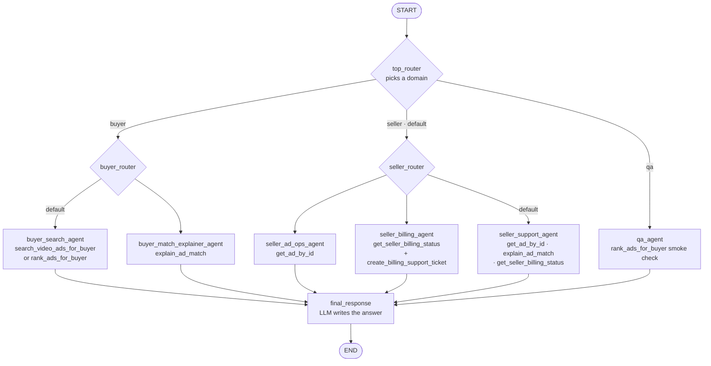
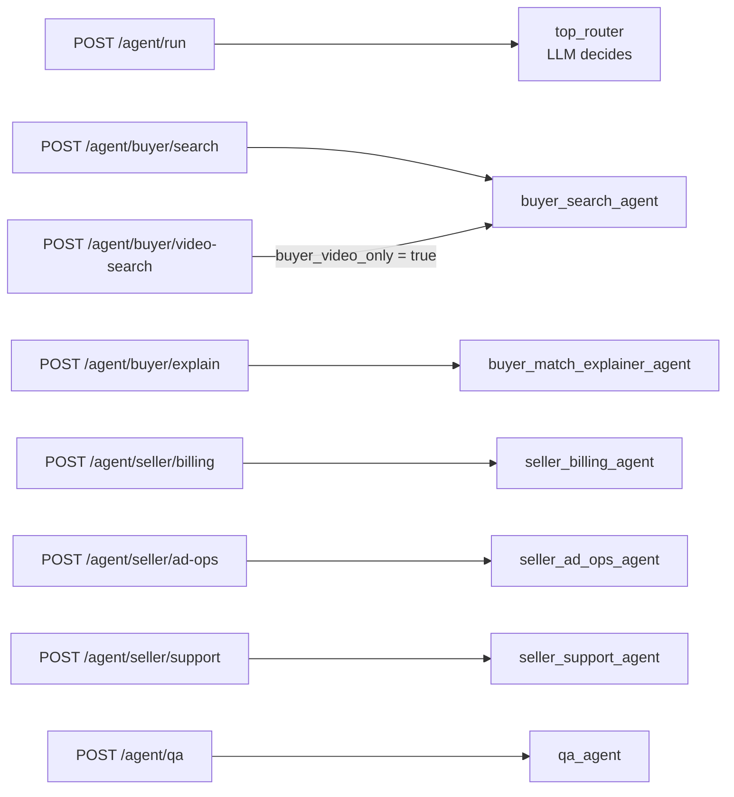
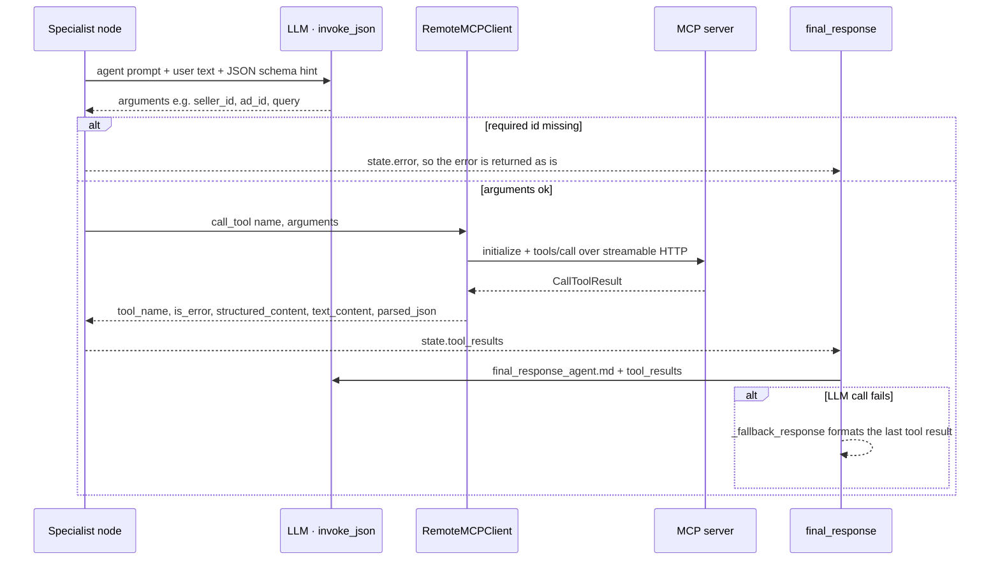

# LangGraph Runtime

This package is the first runnable LangGraph scaffold for the LLM Ad Engine.

## Architecture

- top router
- buyer subgraph
- seller subgraph
- optional QA path
- final response node

This is the graph built in `graph.py`. Each node is one LLM step, and only the specialist nodes call MCP tools.



The routers can be skipped. The HTTP endpoints set `forced_domain` and `forced_specialist`, so only `/agent/run` uses the LLM routers:



Inside a specialist node, the pattern is the same each time:



## LLM Stack

- model: `nvidia/nemotron-3-ultra-550b-a55b`
- API shape: OpenAI-compatible NIM endpoint

## Hosted NVIDIA API

This project is currently using NVIDIA's hosted API, not a self-hosted NIM running inside your GCP project.

- model catalog and API key management: `https://build.nvidia.com`
- runtime inference endpoint: `https://integrate.api.nvidia.com/v1`
- configured model: `nvidia/nemotron-3-ultra-550b-a55b`

That means your LangGraph app sends requests from your runtime to NVIDIA's hosted service over HTTPS.
If you later move to a true NIM deployment, the main change should be swapping `LLM_BASE_URL`
and, if needed, the auth method.

## MCP Tool Layer

- remote Cloud Run MCP server
- streamable HTTP transport
- target endpoint: `https://ad-engine-mcp-v2-610270819686.us-west1.run.app/mcp`

## Files

- `config.py`: environment-driven runtime settings
- `models.py`: Nemotron Ultra chat model factory
- `mcp_client.py`: remote MCP client wrapper
- `nodes.py`: LangGraph node implementations
- `graph.py`: graph construction
- `main.py`: simple CLI entrypoint

## Setup

```bash
cd /Users/tzechungkao/llm-ad-engine/langgraph_app
python3 -m venv .venv
source .venv/bin/activate
pip install -r requirements.txt
cp .env.example .env
```

## Environment

```env
LLM_BASE_URL=https://integrate.api.nvidia.com/v1
LLM_MODEL=nvidia/nemotron-3-ultra-550b-a55b
LLM_API_KEY=YOUR_NVIDIA_KEY

MCP_SERVER_URL=https://ad-engine-mcp-v2-610270819686.us-west1.run.app/mcp
MCP_SERVER_AUTH_TOKEN=

SYNTHETIC_DEVICE_ID=langgraph-buyer-device
DEFAULT_SEARCH_LIMIT=5
DEFAULT_EXPLAIN_LIMIT=10
LLM_TEMPERATURE=0.1
```

If your deployed MCP service terminates at the root path instead of `/mcp`, update `MCP_SERVER_URL` accordingly.
If you rotate your NVIDIA API key, only `LLM_API_KEY` needs to change for the hosted setup.

## Run

```bash
cd /Users/tzechungkao/llm-ad-engine
source langgraph_app/.venv/bin/activate
python -m langgraph_app.main "Find video ads for trail running shoes"
```

## API Wrapper

Start the local API wrapper:

```bash
cd /Users/tzechungkao/llm-ad-engine
langgraph_app/.venv/bin/uvicorn langgraph_app.api:app --host 0.0.0.0 --port 8010
```

Open the chatbot UI:

```text
http://127.0.0.1:8010/portal
```

Example buyer request:

```bash
curl -s -X POST http://127.0.0.1:8010/agent/buyer/search \
  -H "Content-Type: application/json" \
  -d '{"prompt":"Find video ads for cat furniture"}'
```

Example seller billing request:

```bash
curl -s -X POST http://127.0.0.1:8010/agent/seller/billing \
  -H "Content-Type: application/json" \
  -d '{"prompt":"Check billing status for seller 0d162d0e-83ca-474d-a17c-8616475d4e99"}'
```

## Chatbot UI

The local API wrapper now serves separate browser entry points for buyers and sellers.

- `/portal`: landing page that links to the audience-specific sites
- `/buyer`: buyer-only chat for video ad search and match explanation
- `/seller`: seller-only chat for billing, ad lookup, and support
- `/chat`: shared internal hub for mixed routing and QA
- tool trace: every page still shows which MCP-backed tools were used for each answer

This keeps the public experience cleaner because buyers and sellers no longer share the same interface.
The buyer page now forces the MCP `search_video_ads_for_buyer` path for its main search task, so it behaves like a video-first buyer experience instead of a generic ranked-ad search.

## Smoke Test

```bash
cd /Users/tzechungkao/llm-ad-engine
bash langgraph_app/smoke_test.sh
```

See these docs for more detail:

- `/Users/tzechungkao/llm-ad-engine/docs/langgraph_smoke_tests.md`
- `/Users/tzechungkao/llm-ad-engine/docs/agent_entrypoints.md`
- `/Users/tzechungkao/llm-ad-engine/docs/langgraph_cloud_run_deploy.md`
- `/Users/tzechungkao/llm-ad-engine/docs/nim_gcp_migration_plan.md`

## Finding Real UUIDs

For repeatable seller and ad tests, the easiest source of real UUIDs is the live backend API.

Use your current service token:

```bash
TOKEN="YOUR_CURRENT_SERVICE_TOKEN"
```

List ads:

```bash
curl -s -H "Authorization: Bearer $TOKEN" \
  https://ad-engine-api-610270819686.us-west1.run.app/api/ads | python3 -m json.tool
```

List sellers:

```bash
curl -s -H "Authorization: Bearer $TOKEN" \
  https://ad-engine-api-610270819686.us-west1.run.app/api/sellers | python3 -m json.tool
```

Recommended workflow:

- Use `/api/ads` to get a real `ad_id`
- Use `/api/sellers` to get a real `seller_id`
- If an ad response already includes `seller_id`, you can reuse it for seller-side tests
- Buyer-side LangGraph prompts usually do not need a buyer UUID because the current buyer tools use query text plus `device_id`

Current known-good examples:

- `AD_ID=aa622160-c5a9-4241-b8ca-77b30dc79a3a`
- `SELLER_ID=0d162d0e-83ca-474d-a17c-8616475d4e99`

## Notes

- This is a production-safe v1 shape: router -> one subgraph -> one specialist -> final response.
- It intentionally avoids A2A and deep recursive agent-to-agent flows.
- Prompt files are loaded from `/agents/prompts` so you can tune agent behavior without rewriting the graph runtime.
- The current configuration assumes the new `ad-engine-mcp-v2` MCP service that exposes both buyer and seller tools.
- A root-level `Dockerfile` is included so this repo can be deployed directly to Cloud Run as the LangGraph chat service.
